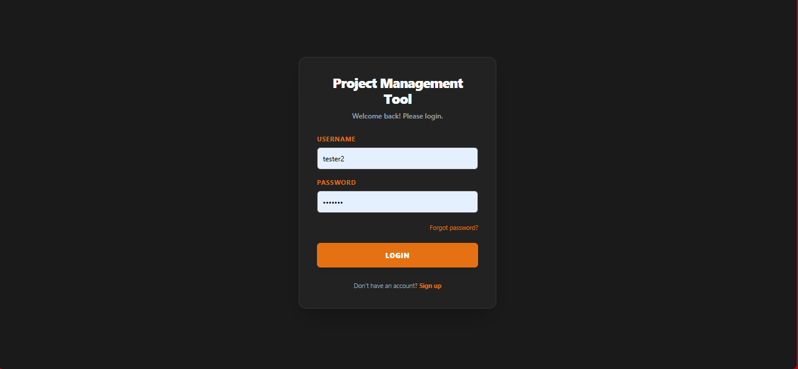
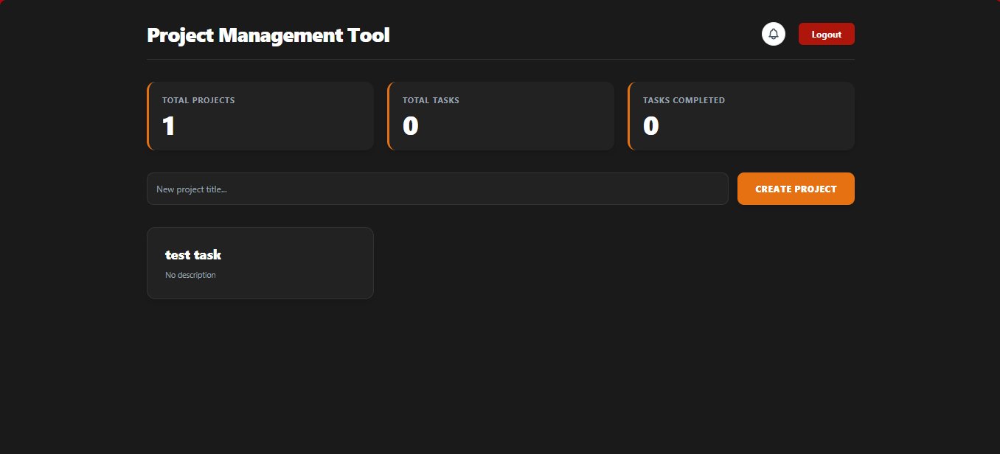

# 🚀 Project Management Tool (CodeAlpha Task 3)

A full-stack collaborative project management tool built with **React, Django REST Framework, and WebSockets**. This application allows teams to create projects, manage tasks on a Kanban board, comment on tasks, and receive real-time updates.

## 📸 Screenshots

### 1. Authentication (Login & Register)
A secure JWT-based login system with a modern dark gradient UI.


### 2. Dashboard & Analytics
View all your active projects and track overall stats (Total Projects, Tasks, and Completed Tasks).


### 3. Kanban Board & Task Management
A fully functional drag-and-drop Kanban board with three columns (To Do, In Progress, Done).


### 4. Task Modal & Comments
Click any task to open a modal where you can edit descriptions, change statuses, and communicate via comments.


### 5. Real-Time Notifications
Get instant pop-up notifications when someone invites you to a project or comments on your tasks.


---

## ✨ Features

- **User Authentication:** Secure JWT (JSON Web Token) login and registration.
- **Project Management:** Create, view, and delete group projects.
- **Kanban Boards:** Drag and drop task cards across To Do, In Progress, and Done columns.
- **Task Details:** Add descriptions, delete tasks, and change statuses directly from the task modal.
- **Team Collaboration:** Invite team members to projects by username.
- **Comments:** Leave real-time comments inside task cards.
- **Real-Time Updates (Bonus):** Using WebSockets, task movements and comments sync instantly across all users in the same project.
- **Notifications:** A built-in notification bell for project invites and new comments.
- **Analytics Dashboard:** A dashboard showing total projects, total tasks, and completed tasks.
- **Responsive UI:** A modern, dark-themed UI built with Tailwind CSS.

## 🛠️ Tech Stack

**Frontend:**
- React (Vite)
- Tailwind CSS (for styling)
- `@hello-pangea/dnd` (for Drag and Drop)
- `react-router-dom` (for routing)
- `axios` (for API requests)
- `react-toastify` (for toast notifications)

**Backend:**
- Python / Django
- Django REST Framework (DRF)
- Django Channels (for WebSockets)
- SimpleJWT (for authentication)
- SQLite (Development Database)
- Uvicorn (ASGI server)

---

## 🚀 How to Run Locally

### Prerequisites
- Python 3.10+
- Node.js 18+
- Git

### 1. Clone the Repository
```bash
git clone https://github.com/your-username/CodeAlpha_Project-Management-Tool.git
cd CodeAlpha_Project-Management-Tool